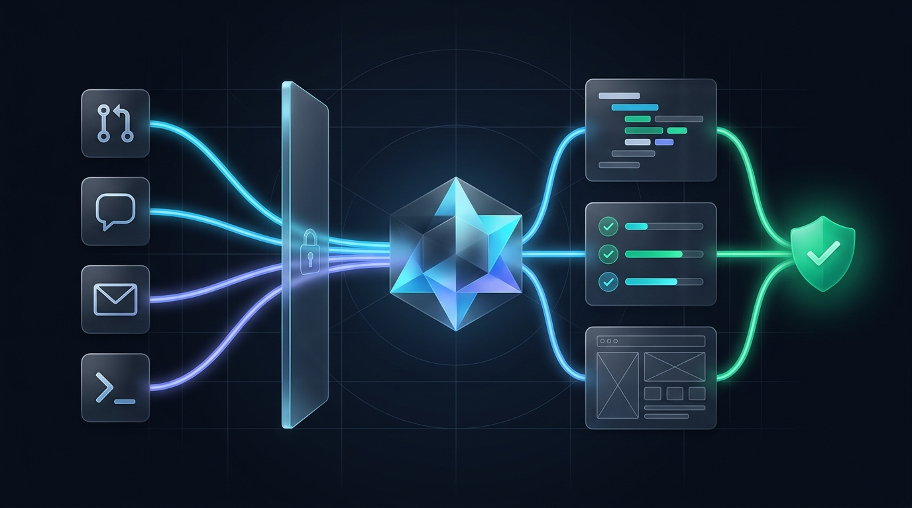

<p align="center">
  
</p>

<h1 align="center">Super Agent</h1>

<p align="center">
  <strong>An Always-On, Autonomous Multi-Session Engineering Agent Built on DeepSeek Harness (DSH)</strong><br>
  <sub>Multi-Channel Intake · Three-Layer Code Gate · Elastic Multi-Session Division &amp; Per-Slot Model Routing · 60% Lossless Context Relay · Independent Review</sub>
</p>

<p align="center">
  <a href="README.md">简体中文</a> &nbsp;·&nbsp;
  <a href="README.en.md"><strong>English</strong></a> &nbsp;·&nbsp;
  <a href="README.ja.md">日本語</a> &nbsp;·&nbsp;
  <a href="https://xyt071024.github.io/dsh-superagent-cn/en/index.html">Documentation</a> &nbsp;·&nbsp;
  <a href="https://xyt071024.github.io/dsh-superagent-cn/en/install.html">Install Guide</a>
</p>

<p align="center">
  <a href="https://github.com/xyt071024/dsh-superagent-cn/releases"></a>
  <a href="LICENSE"></a>
  
  
  
</p>

---

## Why Super Agent?

Conventional AI assistants wait passively for one prompt at a time inside a single context window. On cross-module engineering tasks, multi-channel team requests, or long-running builds, a single conversation quickly hits context degradation, unverified self-approval, and lost progress.

**Super Agent (`dsh-superagent`)** turns DeepSeek Harness into a persistent, autonomous engineering coordinator:

- **Proactive Multi-Channel Intake**: Listens across **GitHub, Feishu, Personal QQ, Official QQBot, WeChat, WeCom, IMAP/SMTP Mail (including Gmail)**, and the local DSH chat panel. Incoming events pass through a code-enforced authorization gate and semantic assessment before becoming durable **Tickets**.
- **Zero Overhead for Simple Work, Elastic Parallelism for Hard Work**: Trivial fixes run in a single worker (`0` extra sessions). Complex cross-module assignments automatically split into **independently openable Division Sessions** visible in the DSH sidebar. Each task defaults to an allowance of **5** division sessions, freely adjustable up or down by the operator (`1`, `5`, `8`, `17`, `32`, or more — no hardcoded 16 cap), with per-slot `provider/model` overrides or automatic inheritance of the task-start model.
- **60% Lossless Context Relay**: Across Master Orchestrator, Ticket Worker, Subagent, and Division roles, reaching the context threshold (default **60%**) automatically distills intent, constraints, tail progress, and unassigned shared tasks into a fresh generation session (`r1 → r2 → r3`), seamlessly routing follow-up messages from older windows to the latest generation.
- **Independent Read-Only Review Loop**: When divisions complete, an isolated read-only **Independent Reviewer** session bound to the exact deliverable fingerprint inspects actual files and test outputs, sending defects back for rework (up to **3 rounds**) and rejecting stale late approvals from superseded rounds.

---

## Architecture Overview

<p align="center">
  
</p>

### Four Architectural Guarantees

1. **Three-Layer Hard Authorization (`Code Gate → Semantic Eval → Credential Mandate`)**
   Allowlists, tool write guards, environment shims, and reply word limits are enforced in host code. Untrusted messages, comments, or webpages can never escalate permissions.
2. **Strict Separation of Routing and Execution**
   The Master Orchestrator (`dsh-superagent-router`) routes candidates in milliseconds; commands or job waits exceeding **5 seconds** automatically move to the background so incoming events never stall. Workers (`dsh-superagent-worker`) execute inside isolated ticket directories.
3. **Transactional SQLite WAL Persistence**
   Tickets, `TaskPlan` records, `pendingDeliveries`, `SessionRelay` routes, `reviewHistory`, and daily token budgets persist atomically in SQLite, surviving restarts and transient network drops without re-running completed work.
4. **Scoped Environment Isolation (`isolateEnvironment: true`)**
   Per-ticket `gh` / `lark-cli` credential wrappers and blocked-command shims stay strictly scoped to worker subprocesses without mutating global host `PATH` or existing user profiles.

---

## Core Engines

### 1. Autonomous Multi-Session Division & Per-Slot Model Routing

<p align="center">
  
</p>

- **On-Demand Splitting**: Extracts parallel deliverables from explicit role clauses, bulleted lists, or multi-domain engineering tracks (`api`, `ui`, `db`, `auth`, `security`, `test`, `docs`, `deploy`).
- **Default Allowance of 5, Operator-Adjustable Without a Fixed Cap (`M07-m`)**: Fresh installations default to `maxSessions = 5` while preserving any previously saved operator settings (such as `3` or `8`). Operators can configure any positive safe integer (`1`, `5`, `8`, `17`, `32`, …) with batched slot browsing in the UI, $O(\text{used})$ slot allocation, and compact override-only prompt summaries. Excess items beyond `maxSessions` remain visible in `deferredDivisions` for the coordinator or subsequent batches.
- **Safe Plan Revisions**: Revising a live plan preserves completed unchanged divisions, archives prior results into `resultHistory` when reopening modified divisions, Renews pending reviews when deliverable scope changes, and actively cancels running host sessions before removing divisions.

### 2. 60% Threshold Endless Context Relay

<p align="center">
  
</p>

- **Head + Tail Budgeted Summaries**: Preserves the original task assignment alongside the newest tail progress and carried-over shared tasks instead of truncating from the end.
- **Commit-Before-Wake Safety**: Injects the handover summary silently, commits the generation pointer and `pendingActivation` atomically in SQLite, and wakes the successor session only after commit — with automatic wake-up retry on recovery and zero duplicate initial dispatch.

### 3. 14 Bundled Engineering & Channel Skills + `orchestrator_division_todo`

Mounted automatically via `DSH_BUNDLED_SKILL_DIR` with progressive disclosure:

- **Engineering & Verification**: `code-navigation`, `planning-loop`, `gui-browser`, `frontend-design`, `diagnostics`, `delegate`, `verify`, `research`, `shell`, `install`, `mirror`, `docs`
- **Channel Operations**: `dsh-superagent-github`, `dsh-superagent-feishu`
- **Persistent Division Checklist Tool**: `orchestrator_division_todo` (incremental merge-by-ID checklist persisted on `DivisionRecord` across restarts and 60% handovers)

---

## Installation & Lossless Upgrade

### Option 1: One-Line Installer (Dynamic Release Resolution + SHA-256 Verification)

**Windows (PowerShell):**
```powershell
irm https://xyt071024.github.io/dsh-superagent-cn/install.ps1 | iex
```

**macOS / Linux (Bash):**
```bash
curl -fsSL https://xyt071024.github.io/dsh-superagent-cn/install.sh | bash
```

### Option 2: Zero-Dependency Bundled Archives (Includes Node.js + DSH Runtime)

Download from [GitHub Releases](https://github.com/xyt071024/dsh-superagent-cn/releases/latest):

| Target Environment | Release Asset | How to Start |
|---|---|---|
| **Windows x64** (Zero pre-requisites) | `Super-Agent-Bundled-Windows-x64-v0.3.20.zip` | Extract and run `start.cmd` |
| **macOS Apple Silicon (arm64)** | `Super-Agent-Bundled-macOS-arm64-v0.3.20.zip` | Extract and run `./start.sh` |
| **macOS Intel (x64)** | `Super-Agent-Bundled-macOS-x64-v0.3.20.zip` | Extract and run `./start.sh` |
| **Linux x64** | `Super-Agent-Bundled-Linux-x64-v0.3.20.zip` | Extract and run `./start.sh` |
| **Existing DSH Profile (Plugin Only)** | `Super-Agent-Plugin-v0.3.20.tgz` | `dsh plugin add ./Super-Agent-Plugin-v0.3.20.tgz` |

---

## Verification & Quality Matrix

| Scope | Status | Evidence |
|---|---|---|
| **Typecheck & Bundle Build** | ✅ **Passed** | `tsc --noEmit` 0 errors; 21 built `lib/` modules match standalone `.tgz` and all 4 platform ZIPs |
| **Full Vitest Suite (Windows)** | ✅ **1,370 Passed / 0 Failed / 15 Skipped** | 77 test files green (including channel parsers, proactive peer offers, real merge test gates, review independence & speculative drafts; 15 POSIX-only service-script tests skipped on Windows) |
| **GitHub Actions CI (Linux & Windows)** | ✅ **4 Jobs Green** | Full Linux suite, Unix & Windows bootstrap/packaging self-tests, Python release-preflight unit tests, and installer script & pinned-version checks |
| **Independent Acceptance Suites (`41–50`)** | ✅ **37 / 37 Passed** | Covers handover races, multi-generation routing, multi-deliverable splitting, review isolation, plan revisions, and configurable `maxSessions` |
| **Isolated Windows Bundle Install & Upgrade** | ✅ **HTTP 200 Verified** | Fresh install, missing-plugin repair, and legacy profile upgrade all preserve user config and serve `/orchestrator/api/state` (`0.3.20`) |
| **Security & Secret Preflight (`release_preflight`)** | ✅ **0 Issues** | Full byte scan across all 5 release artifacts for keys, tokens, credentials, links, Unix `0755` modes, and local paths |
| **Physical macOS / Linux GUI & Live Accounts** | ⚠️ **Pending Live Hardware/Accounts** | Verified via Linux CI, archive permissions, and local protocol servers; live external credentials intentionally excluded from automated runs |

---

## Credits & License

- **Upstream**: [deepseek-ai/dsh-superagent-prototype](https://github.com/deepseek-ai/dsh-superagent-prototype) (MIT) & [DeepSeek Harness](https://github.com/deepseek-ai).
- **Engineering Reference**: [elder-plinius/CL4R1T4S](https://github.com/elder-plinius/CL4R1T4S) (GPLv3 public corpus, studied as an external reference for multi-agent prompt structure and checklist tool design; all skills, prompts, and code in this repository are original, independently written MIT implementations).
- **Disclaimer**: Unofficial community distribution, not affiliated with or endorsed by DeepSeek. Released under the [MIT License](LICENSE).
