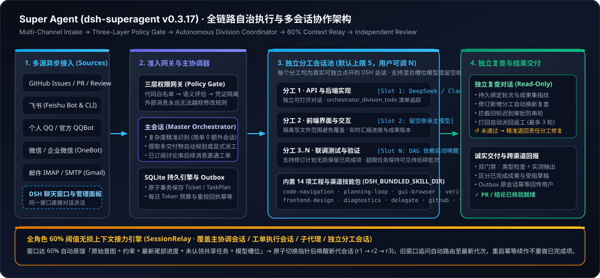

# Super Agent for DeepSeek Harness

  <a href="README.md">简体中文</a> &nbsp;·&nbsp;
  <a href="README.en.md"><strong>English</strong></a> &nbsp;·&nbsp;
  <a href="README.ja.md">日本語</a> &nbsp;·&nbsp;
  <a href="https://xyt071024.github.io/dsh-superagent-cn/en/install.html">Install Guide</a> &nbsp;·&nbsp;
  <a href="CHANGELOG.md">Changelog</a> &nbsp;·&nbsp;
  <a href="https://github.com/xyt071024/dsh-superagent-cn/releases">Releases</a>

Super Agent is a community-maintained DeepSeek Harness (DSH) plugin. It connects workspace chat, external messages, and background tickets. You can assign a project task from one main conversation, let multiple independent conversations work on parallel parts, and return to the main conversation to check progress, test results, and review feedback.

## Start from a Task

For example, when you need to modify a feature, add tests, and verify the install guide at the same time, create a chat in your DSH workspace, pick the Super Agent auto-division preset, and enable automatic division in the plugin settings. Once the task starts, you can open each division conversation in the same workspace to give additional instructions to a specific member, or check the consolidated summary back in the main conversation. Simple tasks stay in the current chat. Actual split counts and throughput depend on the task, chosen models, and provider concurrency limits.

Fresh profiles default to allowing up to 5 extra division conversations per task. You can adjust that limit and assign a provider and model to each slot. Unassigned slots inherit the model active in the originating main chat. Independent review is tracked separately. Settings also provide complexity thresholds, reasoning effort, and daily token budget controls.

## How Work Moves End to End

  

- **Intake.** Workspace chats can launch tasks directly. Configured external sources convert incoming messages into events carrying conversation or thread identifiers. Based on intake policy, ticket linkage, and authorization scope, the runtime decides whether to continue existing work, enter evaluation, or stay quiet.
- **Division & Collaboration.** The coordinator records work items, dependencies, and owners. Members keep independent contexts and can message peers directly, publish splittable work items, claim open items from other members, and submit deliverables back to the original owner. Progress and blocking reasons remain persisted in the task record.
- **Verification & Review.** Code work items require controlled test results tied to the current deliverable version. Documentation and research items can record explicit manual acceptance notes. When independent review is enabled, review findings can trigger rework rounds. Long tasks support context compression and session handover at a configurable threshold (60% by default).
- **Outbound Delivery.** The outbox persists pending, sent, and dropped receipts. Drafts requiring confirmation can be prepared first and explicitly sent or revoked by the user. While processing or a channel is paused, drafts remain pending and update their delivery state strictly from actual outbox receipts.

## Entrypoints & Requirements

| Entrypoint | Prerequisites |
|---|---|
| DSH Workspace Chat | Configure a working model connection and pick the auto-division preset inside the target workspace |
| GitHub | Connect the target repository with credentials, watched scope, and permitted actions |
| Personal QQ, WeChat, WeCom | Use a compatible OneBot gateway, log in per the gateway's instructions, and configure event/message endpoints; some setups require a separate background gateway service |
| Official QQ Bot | Configure Tencent Open Platform bot credentials within the bot's authorized scope |
| Feishu, Gmail / Email | Configure bot or mailbox authorization per the integration guide; email uses IMAP for intake and SMTP for sending |

## Installation & First Run

1. Choose an asset on the release page. If you already have a compatible DSH environment, use the standalone plugin tarball; self-contained bundles are built for Windows x64, Linux x64, macOS Intel, and macOS Apple Silicon. [Releases](https://github.com/xyt071024/dsh-superagent-cn/releases)
2. Extract the archive for your platform. Run `start.cmd` on Windows or `./start.sh` on Linux/macOS, then open the local panel URL printed by the launcher. Check the environment requirements and platform verification scope before installing. [Install Guide](https://xyt071024.github.io/dsh-superagent-cn/en/install.html)
3. Configure your model connection first, then review division, model, and budget options under **Superagent → Settings**. Try a read-only task first (for example, auditing the install guide, config examples, and changelog in parallel) before connecting external accounts.

## Origin & License

This project builds on the public Super-agent prototype released by the DeepSeek Harness team, adding workspace-scoped independent divisions, peer collaboration, per-slot model configuration, Chinese usability improvements, and multi-platform packaging. It is independently maintained by the community under the MIT License. See each Release page for per-version test statistics and known limitations. [Upstream Prototype](https://github.com/deepseek-ai/dsh-superagent-prototype) · [Repository](https://github.com/xyt071024/dsh-superagent-cn)
