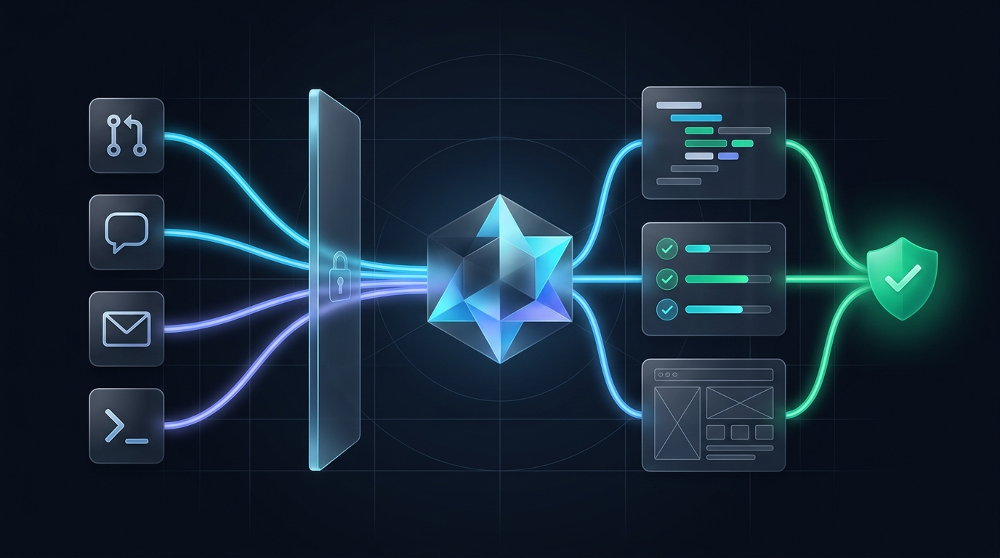
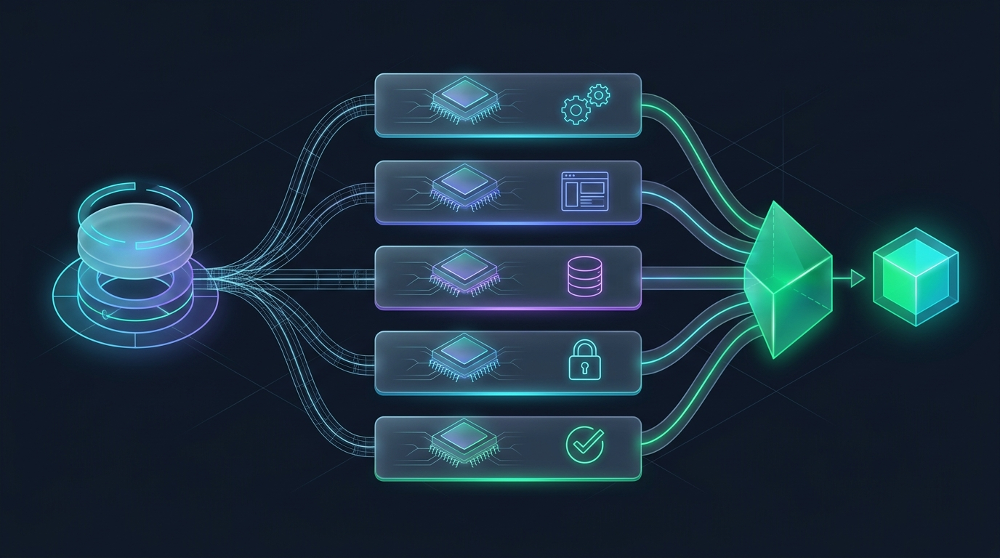
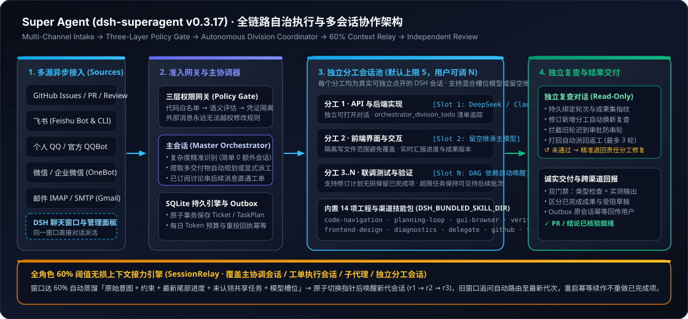

<p align="center">
  
</p>

<h1 align="center">Super Agent for DeepSeek Harness</h1>

<p align="center">
  <a href="README.md">简体中文</a> &nbsp;·&nbsp;
  <a href="README.en.md">English</a> &nbsp;·&nbsp;
  <a href="README.ja.md"><strong>日本語</strong></a> &nbsp;·&nbsp;
  <a href="https://xyt071024.github.io/dsh-superagent-cn/ja/index.html">ドキュメント</a> &nbsp;·&nbsp;
  <a href="https://xyt071024.github.io/dsh-superagent-cn/ja/install.html">導入ガイド</a> &nbsp;·&nbsp;
  <a href="CHANGELOG.md">変更履歴</a>
</p>

<p align="center">
  <a href="https://github.com/xyt071024/dsh-superagent-cn/releases/latest"></a>
  <a href="LICENSE"></a>
  
  
  
</p>

Super Agent はコミュニティが保守する DeepSeek Harness（DSH）プラグインです。ワークスペースのチャット、外部メッセージ、バックグラウンドチケットを接続します。メイン会話からプロジェクトのタスクを指示し、並列化できる作業を複数の独立した会話で進め、メイン会話で進捗・テスト結果・レビュー結果を確認できます。

---

## ひとつのタスクから始める

たとえば機能修正、テスト追加、インストール手順の確認を同時に進める場合、DSH ワークスペースで新しいチャットを開き、Super Agent の自動分担プリセットを選択してプラグイン設定で自動分担を有効にします。タスク開始後は、同じワークスペース内で各分担会話を個別に開いて追加指示を出したり、メイン会話で集約結果を確認したりできます。単純な作業は現在のチャットにとどまります。実際の分割数や速度はタスク内容、選択モデル、プロバイダーの同時実行制限に依存します。

新規プロファイルでは 1 タスクあたり最大 **5** つの追加分担会話が既定で許可されます。上限数は固定上限なしで自由に調整でき（ページング到達とスパース保存に対応）、各スロットにプロバイダーとモデルを指定できます。空欄のスロットはタスク開始時のメインチャットで使用しているモデルを厳格に継承します。独立レビューは別枠で記録され、難易度しきい値・思考強度・日次トークン予算管理も設定可能です。

<p align="center">
  
</p>

---

## 作業の流れ

<p align="center">
  
</p>

- **受付（Intake）。** ワークスペースのチャットから直接タスクを開始できます。設定済みの外部ソースはメッセージを会話・スレッド識別子付きイベントへ変換し、コード強制ポリシーと権限範囲に基づいて継続・評価・静観を判断します。外部メッセージや Web コンテンツによる権限昇格はできません。
- **分担と協調。** コーディネーターが作業項目、依存関係、担当者をローカル SQLite に永続記録します。各メンバーは独立したコンテキストを持ち、直接連絡、分割可能項目の公開、他メンバーの空き項目の引き受け、元担当者への提出を行えます。
- **検証とレビュー。** コード作業項目は当該納品バージョンに対応する制御テスト結果が必須です（結果欠落・虚偽合格・期限切れ・コード項目の手動検収をすべて拒否）。ドキュメント・調査項目は手動検収の根拠を記録できます。独立レビュー有効時は作成者の自己承認を禁止し、最大 3 ラウンドの差し戻し修正に対応します。
- **コンテキストリレー。** メイン・チケットワーカー・サブエージェント・分担セッションのすべてで設定しきい値（既定 **60%**）到達時に要約を抽出し新世代セッション（`r1 → r2 → r3`）へ無損失で引き継ぎます。旧ウィンドウへの追記も最新世代へ自動転送されます。
- **外部返信と障害復旧。** 送信トレイ（Outbox）が待機中・送信済み・破棄の受領状態を永続化します。確認が必要な下書きはユーザー承認まで外発せず、一時停止やオフライン中は待機状態を維持し、復旧後は同一キーで 1 回のみ送信して実受領結果で完了更新します。`v0.4.0` では PID 認識型ディレクトリロックを導入し、稼働中インスタンスのロックを守りつつ Windows 強制終了後の即時再起動でも孤立ロックを安全に回収します。

<p align="center">
  
</p>

---

## 接続入口と利用条件

| 入口 | 利用条件 |
|---|---|
| **DSH ワークスペースチャット** | 利用可能なモデル接続を設定し、対象ワークスペース内で自動分担プリセットを選択 |
| **GitHub** | 対象リポジトリを接続し、認証情報・監視範囲・操作権限を設定（Issue/PR タイトルと本文の `@` メンションに対応） |
| **個人 QQ・WeChat・WeCom** | 互換 OneBot ゲートウェイを用意し、手順に従ってログインおよびイベント／メッセージ API を設定（同一グループ／DM 権限付き引用参照と画像添付に対応、別途バックグラウンドサービスが必要な場合あり） |
| **公式 QQ Bot** | Tencent Open Platform のボット認証情報を設定し、許可された範囲で送受信 |
| **Feishu・Gmail／メール** | 導入ガイドに従ってボット（`post` リッチテキスト・埋込画像対応）またはメール認証を設定（受信 IMAP・送信 SMTP） |

---

## インストールと初回利用

### 方法 1：ワンライナー導入スクリプト（最新版の動的解決＋SHA-256 検証）

**Windows（PowerShell）：**
```powershell
irm https://xyt071024.github.io/dsh-superagent-cn/install.ps1 | iex
```

**macOS / Linux（Bash）：**
```bash
curl -fsSL https://xyt071024.github.io/dsh-superagent-cn/install.sh | bash
```

### 方法 2：Node.js・DSH 同梱バンドル版 / プラグイン単体（[v0.4.0 リリース](https://github.com/xyt071024/dsh-superagent-cn/releases/latest)）

| 対象環境 | 配布ファイル | 起動・導入方法 |
|---|---|---|
| **Windows x64**（Node＋DSH 同梱） | `Super-Agent-Bundled-Windows-x64-v0.4.0.zip` | 解凍して `start.cmd` を実行 |
| **macOS Apple Silicon (arm64)** | `Super-Agent-Bundled-macOS-arm64-v0.4.0.zip` | 解凍して `./start.sh` を実行 |
| **macOS Intel (x64)** | `Super-Agent-Bundled-macOS-x64-v0.4.0.zip` | 解凍して `./start.sh` を実行 |
| **Linux x64** | `Super-Agent-Bundled-Linux-x64-v0.4.0.zip` | 解凍して `./start.sh` を実行 |
| **既存 DSH 環境向け単体プラグイン** | `Super-Agent-Plugin-v0.4.0.tgz` | `dsh plugin add ./Super-Agent-Plugin-v0.4.0.tgz` |

---

## v0.4.0 検証状況と適用範囲

- **自動テスト・クロスプラットフォーム CI**：Windows ローカル Vitest（80 ファイル）`1,380 passed | 0 failed | 15 skipped`、Linux CI Vitest（80 ファイル）`1,393 passed | 0 failed | 2 skipped`、独立検収スイート（第 41〜50 号）`37/37 passed`、厳格モード `windows-bundle` `2/2 (0 skipped)`、プリフライト検査 5 成果物 **0 件検出**。
- **Windows 分離実パッケージ検証**：新規導入・修復・無損失アップグレード・HTTP 200・稼働中ロック保護（`ELOCKED`）・強制終了後 **0s / 5s / 35s / 60s** 再起動復旧を確認済み。
- **未検証範囲**：商用 API キーでの実スループット、外部実アカウントでの実送受信、Linux / macOS 実機デスクトップ起動・ロールバック、クラウド常時継続、月跨ぎ長期記憶、自律外部ウォッチドッグは本版の保証対象外です。

---

## プロジェクトの由来・ライセンス

DeepSeek Harness チーム公開の Super-agent プロトタイプを基盤としたコミュニティ保守版です（[MIT License](LICENSE)）。

- **上流プロトタイプ**：[deepseek-ai/dsh-superagent-prototype](https://github.com/deepseek-ai/dsh-superagent-prototype)（MIT）
- **リポジトリ**：[xyt071024/dsh-superagent-cn](https://github.com/xyt071024/dsh-superagent-cn)
