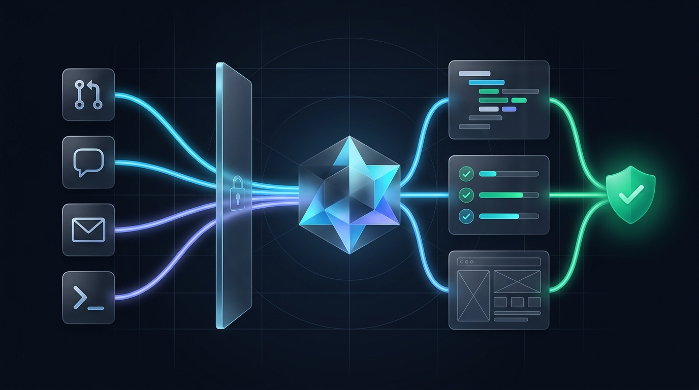
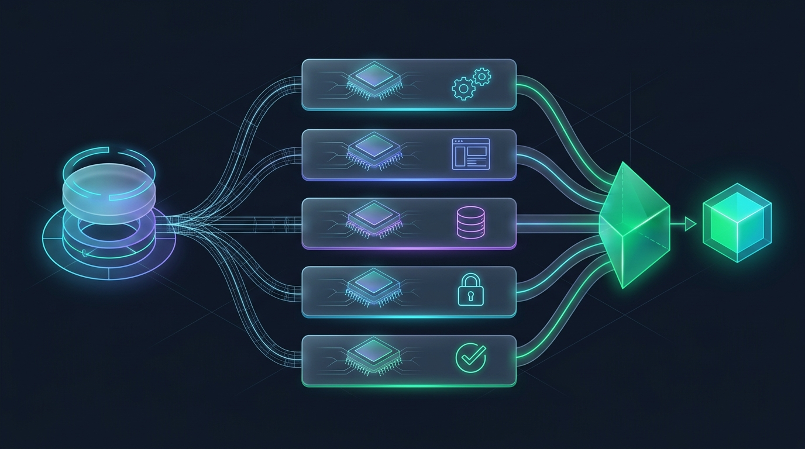
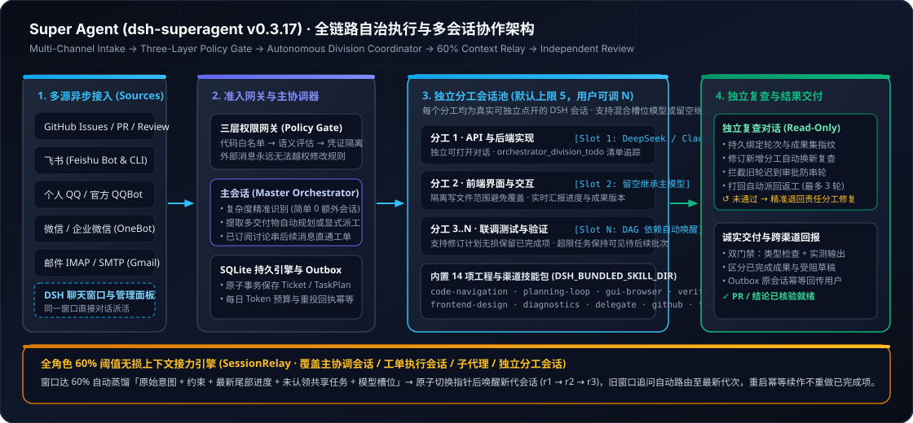

<p align="center">
  
</p>

<h1 align="center">Super Agent for DeepSeek Harness</h1>

<p align="center">
  <a href="README.md"><strong>简体中文</strong></a> &nbsp;·&nbsp;
  <a href="README.en.md">English</a> &nbsp;·&nbsp;
  <a href="README.ja.md">日本語</a> &nbsp;·&nbsp;
  <a href="https://xyt071024.github.io/dsh-superagent-cn/">在线文档站</a> &nbsp;·&nbsp;
  <a href="https://xyt071024.github.io/dsh-superagent-cn/install.html">安装指南</a> &nbsp;·&nbsp;
  <a href="CHANGELOG.md">更新日志</a>
</p>

<p align="center">
  <a href="https://github.com/xyt071024/dsh-superagent-cn/releases/latest"></a>
  <a href="LICENSE"></a>
  
  
  
</p>

Super Agent 是一个由社区维护的 DeepSeek Harness（DSH）插件。它把工作区聊天、外部消息和后台工单连接起来。你可以在一个主对话中布置项目任务，让多个独立对话处理可以并行的部分，再回到主对话查看进度、测试结果和复查意见。

---

## 从一个任务开始

例如，要同时修改一个功能、补测试并核对安装说明，可以在 DSH 工作区新建聊天，选择 Super Agent 自动分工预设，在插件的设置页启用自动分工。发任务后，可以在同一工作区分别打开分工对话，给某个成员补充要求，也可以回到主对话查看汇总。简单任务可以留在当前聊天。实际拆分数量和速度取决于任务、所选模型及供应商并发限制。

新配置默认允许每个任务最多创建 **5** 个额外分工对话。你可以自由调整数量（无固定 16 上限，支持大数量槽位分页直达与稀疏存储），给每个位置指定供应商和模型；留空的位置严格继承发起任务时主聊天使用的模型。独立复查单独记录。设置页也提供难度阈值、思考强度和每日 Token 预算控制。

<p align="center">
  
</p>

---

## 一项工作如何完成

<p align="center">
  
</p>

- **进入项目。** 工作区聊天可以直接发起任务。已配置的外部来源将消息转换成带有会话或讨论串标识的事件。系统依据代码级接入策略、任务关联和授权范围，判断应继续现有工作、进入评估还是保持安静。外部消息、评论或网页内容无法越权。
- **分配与协作。** 协调器在本地 SQLite 中持久记录工作项、依赖和负责人。成员拥有各自的上下文，可以定向沟通、发布可拆分工作、领取其他成员开放的工作项，并向原负责人提交结果。进展、接手轨迹和阻塞原因保留在任务记录里。
- **验收与复查。** 代码工作项强制要求对应本次交付版本的受控测试凭据（拦截缺结果、伪报通过、结果过期与代码项走人工验收）；文档和调研工作可以记录人工验收依据。启用独立复查后，作者不可自审，审查意见可触发最多 3 轮返工。
- **上下文接力。** 长任务支持在主会话、工单会话、子代理与独立分工对话中按设定阈值压缩上下文并接续新一代会话（`r1 → r2 → r3`），默认阈值为 **60%**；旧窗口追问自动路由到最新一代。
- **对外回复与崩溃恢复。** 发件箱（Outbox）持久记录待发、送达与丢弃。需要确认的草稿可以先准备，再由用户在面板或主会话决定发送或撤销；渠道暂停或离线时保持待发状态，恢复后按同一投递键仅外发一次，严格以实际回执更新送达结果。`v0.4.0` 新增 PID 感知状态目录锁，既绝不误删活实例锁，也能在 Windows 强杀重启后立即安全回收遗留锁。

<p align="center">
  
</p>

---

## 接入方式

| 入口 | 使用条件 |
|---|---|
| **DSH 工作区聊天** | 配置一个可用的模型连接；在目标工作区内选择自动分工预设 |
| **GitHub** | 连接目标仓库，配置凭据、监听范围和操作权限（支持 Issue/PR 标题与正文 `@` 提及） |
| **个人 QQ、微信、企业微信** | 使用兼容的 OneBot 网关，按网关要求登录并配置事件与消息接口；支持同群/同私聊引用回查与图片附件读取；部分接入需要独立后台服务 |
| **官方 QQ 机器人** | 使用腾讯开放平台的机器人凭据，按机器人授权范围接收和回复消息 |
| **飞书、Gmail／邮件** | 按接入说明配置机器人（支持 `post` 混合富文本与图片）或邮箱授权；邮件接收与发送分别使用 IMAP、SMTP |

---

## 安装与首次使用

### 方式一：一键在线安装脚本（动态解析最新版本 + SHA-256 校验）

**Windows（PowerShell）：**
```powershell
irm https://xyt071024.github.io/dsh-superagent-cn/install.ps1 | iex
```

**macOS / Linux（Bash）：**
```bash
curl -fsSL https://xyt071024.github.io/dsh-superagent-cn/install.sh | bash
```

### 方式二：全平台零依赖内置包或独立插件包（[v0.4.0 发布页](https://github.com/xyt071024/dsh-superagent-cn/releases/latest)）

| 目标环境 | 发行资产 | 启动 / 安装命令 |
|---|---|---|
| **Windows x64**（自带 Node + DSH） | `Super-Agent-Bundled-Windows-x64-v0.4.0.zip` | 解压后运行 `start.cmd` |
| **macOS Apple Silicon (arm64)** | `Super-Agent-Bundled-macOS-arm64-v0.4.0.zip` | 解压后运行 `./start.sh` |
| **macOS Intel (x64)** | `Super-Agent-Bundled-macOS-x64-v0.4.0.zip` | 解压后运行 `./start.sh` |
| **Linux x64** | `Super-Agent-Bundled-Linux-x64-v0.4.0.zip` | 解压后运行 `./start.sh` |
| **已有兼容 DSH 环境（仅插件）** | `Super-Agent-Plugin-v0.4.0.tgz` | `dsh plugin add ./Super-Agent-Plugin-v0.4.0.tgz` |

### 首次使用建议

1. 解压对应平台的整包后运行 `start.cmd`（Windows）或 `./start.sh`（Linux / macOS），按启动器给出的本地地址进入面板；若已有旧版 `superagent` 配置，启动器会自动备份并无损升级插件，保留你原有的 `cordis.patch.yml` 与其他插件。详见 [安装指南](https://xyt071024.github.io/dsh-superagent-cn/install.html)。
2. 先配置模型，在「超级代理人 → 设置」检查「会话分工与模型」和「上下文与预算」。
3. 第一次可用一个只读任务试用，例如「请分别核对项目的安装说明、配置示例和更新日志，各自给出文件依据，最后汇总」，再按需接入外部账号。

---

## v0.4.0 测试与验证边界

- **自动化与跨平台 CI**：
  - **Windows 本机 Vitest（80 文件）**：`1,380 passed | 0 failed | 15 skipped`（跳过项为 POSIX 专属守护脚本）；
  - **Linux CI Vitest（80 文件）**：`1,393 passed | 0 failed | 2 skipped`（含 15 项 POSIX 守护脚本全量实跑）；
  - **历轮独立验收套件（第 41–50 号，8 文件）**：`37 passed | 0 failed`；
  - **打包与预检**：`unix-bundle` `2/2`、`windows-bundle`（严格实包模式）`2/2（0 跳过）`、`profile-bootstrap-selftest` `8/8`、`test_release_preflight.py` `1/1`，五件成品 `release_preflight.py` 扫描 **0 告警**。
- **Windows 隔离实包全周期**：覆盖全新安装、缺插件修复、旧版无损升级、管理接口 HTTP 200、活实例并发锁保护（`ELOCKED` 绝不删活锁）以及强制终止后 **0s / 5s / 35s / 60s** 全窗口恢复就绪。
- **当前未覆盖范围（请按需实测）**：真实商业模型 API Key 下的端到端吞吐、七条外部渠道真实账号收发联调、Linux / macOS 物理真机桌面启动与升级回滚、云端离线续跑、跨月记忆及独立看门狗自动纠偏均未作为本版实机承诺，具体详情见对应 [GitHub Release](https://github.com/xyt071024/dsh-superagent-cn/releases/latest)。

---

## 项目来源

本项目基于 DeepSeek Harness 团队公开的 Super-agent 原型，在工作区独立分工、成员互助、模型设置、中文使用体验和多平台交付方面进行了扩展。社区独立维护，项目许可为 [MIT License](LICENSE)。

- **上游原型**：[deepseek-ai/dsh-superagent-prototype](https://github.com/deepseek-ai/dsh-superagent-prototype)（MIT）
- **项目仓库**：[xyt071024/dsh-superagent-cn](https://github.com/xyt071024/dsh-superagent-cn)
